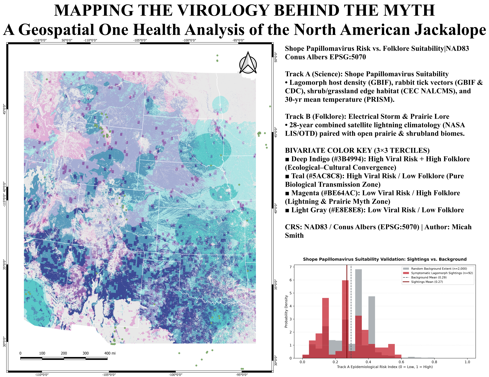
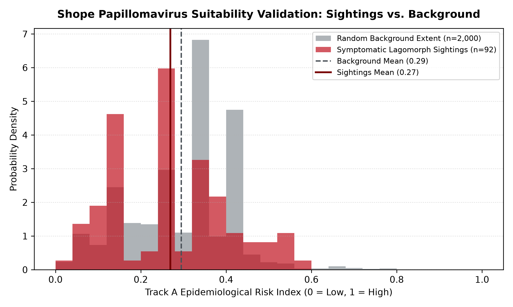

# Mapping the Virology Behind the Myth: A Geospatial One Health Analysis of the North American Jackalope


## Overview
Folklore of the North American **jackalope**—a horned rabbit said to inhabit the windswept plains of the American West and breed only during electrical storms—is rooted in a real wildlife pathology: **Shope papillomavirus** (cottontail rabbit papillomavirus, *Sylvilagus floridanus* papillomavirus). This virus induces keratinous, horn-like cutaneous carcinomas on the heads and necks of wild lagomorphs and is transmitted primarily by arthropod vectors (ticks and mosquitoes).

While peer-reviewed veterinary studies have mapped isolated museum specimens and introductory GIS projects have modeled fictional cryptid habitats, **no prior spatial analysis has united both tracks into a continuous bivariate model**. This project bridges **wildlife disease ecology** and **cultural geography** across the Great Plains and Intermountain West to evaluate where real viral transmission risk overlaps with the environmental conditions of jackalope folklore.

---

## Key Spatial & Analytical Findings
* **Ecological–Cultural Convergence (High Science / High Folklore):** Bivariate synthesis (`3×3` tercile classification) identifies a strong convergence corridor across the **Central and Southern Great Plains** (Kansas, Oklahoma, northern Texas, and eastern Colorado), where dense lagomorph populations, shrub/grassland edge habitat, optimal vector temperatures, and high annual lightning flash rates intersect.
* **Pure Biological Transmission Zones (High Science / Low Folklore):** The **Northern Plains and Upper Midwest** exhibit elevated epidemiological suitability for Shope papillomavirus despite lower lightning climatology and weaker association with Wyoming-centered jackalope lore.
* **Folklore Amplification in Low-Density Biomes (Low Science / High Folklore):** Intermountain basins (including Converse County, Wyoming—the cultural epicenter of the jackalope legend) display high folklore habitat suitability paired with moderate-to-low baseline viral suitability, illustrating how rare symptomatic encounters in sparsely populated landscapes can fuel outsized cultural mythology.
* **Observer Bias vs. Environmental Risk:** Comparing unfiltered citizen-science keyword observations (n = 285, mean risk = 0.269) against random background locations (n = 2,000, mean risk = 0.295; Mann–Whitney U, p = 0.99) demonstrates the critical impact of **urban/roadside observer bias** and keyword noise in raw citizen-science data, underscoring the importance of specimen-verified ground-truthing in wildlife epidemiology.

---

## Cartographic & Statistical Outputs
## Cartographic & Statistical Outputs

### 1. Bivariate Choropleth Poster: Viral Risk vs. Folklore Suitability


### 2. Statistical Validation: Sightings vs. Random Background


* **Main Deliverable:** 11" × 17" Bivariate Choropleth Poster contrasting **Track A (Epidemiological Risk Index)** against **Track B (Folklore Habitat Suitability)** in `NAD83 / Conus Albers (EPSG:5070)`.
* **Statistical Validation:** Probability density comparison of symptomatic lagomorph sightings against random regional background points (`outputs/validation_chart.png`).

---

## Data Sources & Engineering Pipeline

| Track | Layer / Variable | Source | Spatial Resolution / Format | Processing & Ecological Role |
| :--- | :--- | :--- | :--- | :--- |
| **Track A (Science)** | Lagomorph Host Occurrences (*S. floridanus*, *S. audubonii*, *Lepus townsendii*) | [GBIF REST API](https://gbif.org) | Point (`789` cleaned records) | Filtered `uncertainty <= 5,000 m`, post-2000; 50 km Gaussian KDE (`40%` weight) |
| **Track A (Science)** | Arthropod Vector Distribution (*Haemaphysalis leporispalustris* & CDC Tick Surveillance) | [GBIF](https://gbif.org) & [CDC](https://cdc.gov) | Point & County Polygon | 75 km Gaussian KDE supplemented by county surveillance (`20%` weight) |
| **Track A (Science)** | Land Cover & Edge Habitat | [CEC NALCMS 2020](http://cec.org) | 30 m GeoTIFF → 1 km grid | Reclassified 1–5 (`5` = shrub/grassland, `4` = cropland edge; `25%` weight) |
| **Track A (Science)** | 30-Year Mean Temperature (`tmean`) | [PRISM Climate Group](https://oregonstate.edu) | 4 km GeoTIFF → 1 km grid | Reclassified 1–5 for arthropod vector survival (`10°C–20°C` optimal; `15%` weight) |
| **Track B (Folklore)** | 28-Year Combined Lightning Climatology (`1995–2023`) | [NASA GHRC LIS/OTD](https://nasa.gov) | Gridded HDF4 → 1 km grid | Tests electrical-storm breeding folklore (`50%` weight) |
| **Track B (Folklore)** | Open Prairie & Shrubland Biome | [CEC NALCMS 2020](http://cec.org) | 30 m GeoTIFF → 1 km grid | Normalized open-range habitat suitability (`50%` weight) |
| **Validation** | Symptomatic Lagomorph Sightings & Museum Records | [iNaturalist API](https://inaturalist.org) & [PLOS ONE](https://plos.org) | Point (`285` candidates + museum localities) | Sampled against Track A risk surface for statistical validation |

---

## Repository Structure

```text
Jackalope_GIS_Project/
├── scripts/
│   ├── fetch_track_a_data.py          # Automated GBIF & iNaturalist REST API ingestion & EPSG:5070 reprojection
│   ├── fetch_inat_jackalopes.py       # Targeted taxon_id=43094 keyword query for symptomatic lagomorphs
│   ├── Run_Suitability_Pipeline.py    # Master 1 km Albers alignment, HDF4 extraction, KDE & weighted overlay
│   └── build_bivariate_and_stats.py   # 3x3 tercile bivariate classification & Mann-Whitney U validation plot
├── data_raw/                          # Cleaned GeoPackages (.gpkg), CSVs, CDC tick data & state boundaries
├── rasters/
│   └── processed/                     # Standardized 1 km GeoTIFFs & scored validation GeoPackage
├── outputs/
│   └── validation_chart.png           # Publication-ready statistical validation figure
├── Jackalope_Suitability_Map.qgz      # QGIS 3.44 project file with bivariate & inset symbology
├── JOURNAL.md                         # Engineering development log & troubleshooting documentation
└── README.md                          # Project documentation
```

---

## Reproducibility & Setup
1. **Environment:** Built and tested in **QGIS 3.44 LTR (OSGeo4W Python 3.12)** using `geopandas`, `rasterio`, `gdal`, `scipy`, `numpy`, `pandas`, `requests`, and `matplotlib`.
2. **Data Acquisition:** Run `python scripts/fetch_track_a_data.py` followed by `python scripts/fetch_inat_jackalopes.py` to query live biodiversity APIs and generate projected GeoPackages in `data_raw/`.
3. **Raster Modeling:** Place CEC Land Cover, PRISM `tmean`, and NASA `COMB_OTD_TRMM_ISS_AnnualMean.hdf` inside `rasters/raw/`, then execute `python scripts/Run_Suitability_Pipeline.py`.
4. **Bivariate Synthesis & Validation:** Execute `python scripts/build_bivariate_and_stats.py` to generate `bivariate_science_vs_myth.tif` and `outputs/validation_chart.png`, then open `Jackalope_Suitability_Map.qgz` in QGIS 3.44.

---

## Author
**Micah Smith** — GIS & Spatial Analysis Portfolio  
*Background in Geographic Information Systems, Project Management, Wildlife Biology, and Precision Metrology.*
